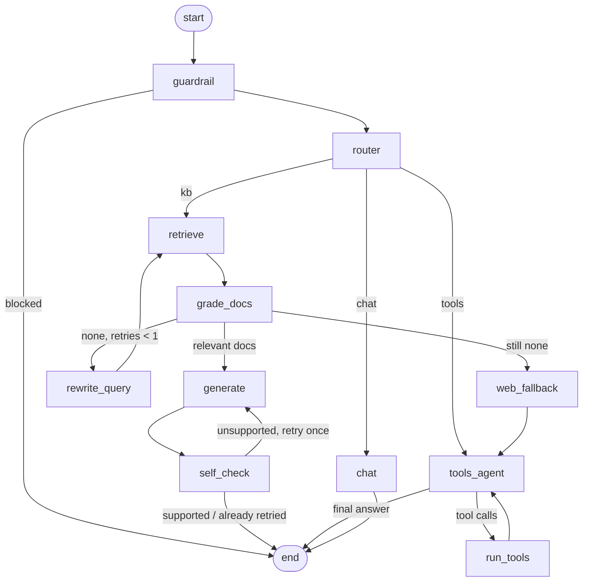
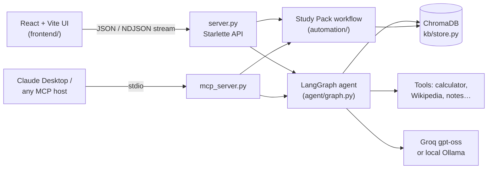
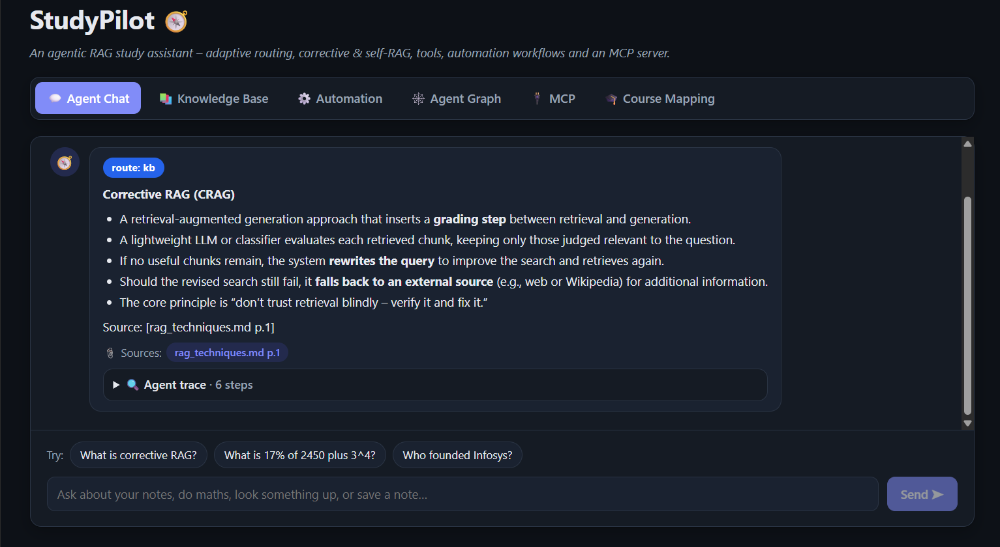
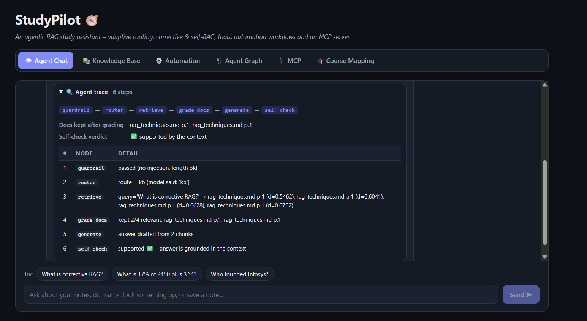
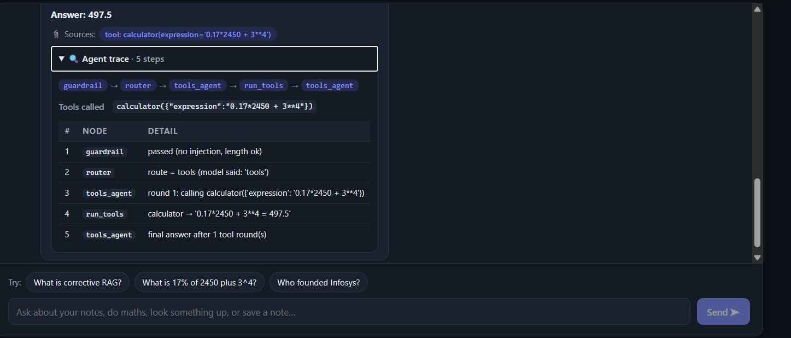
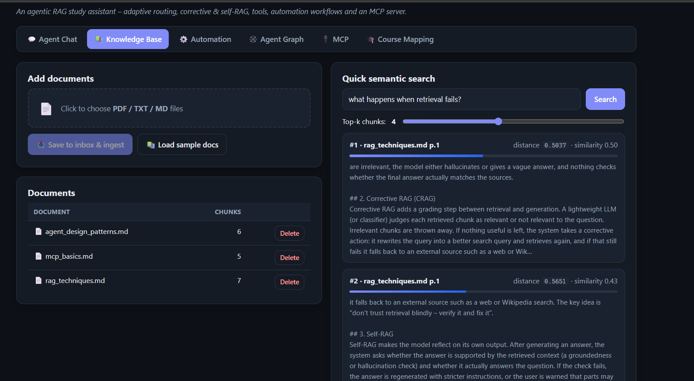
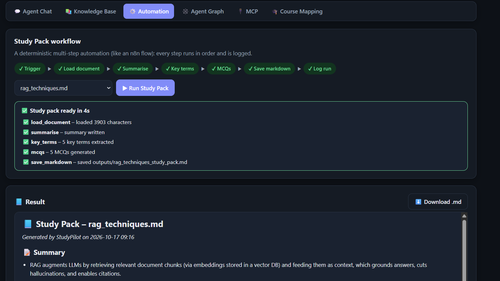
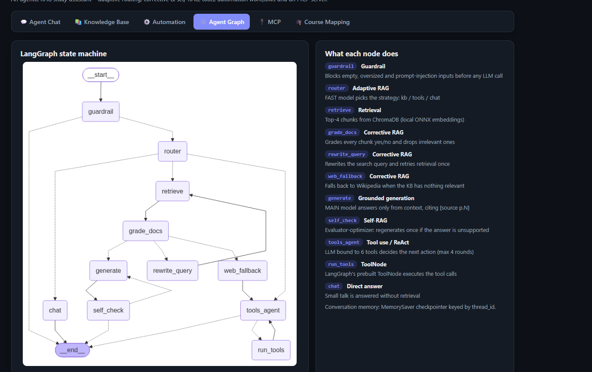
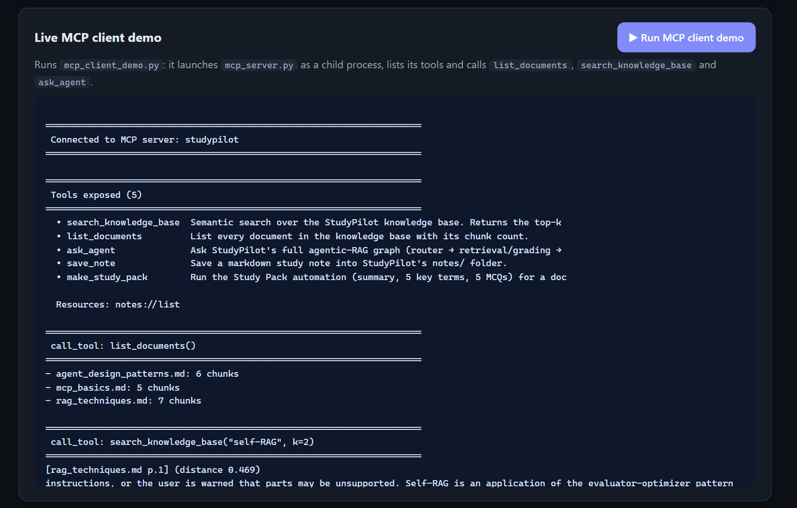
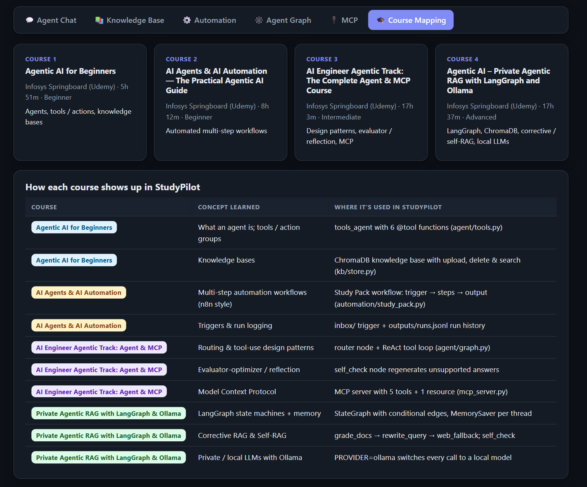

# StudyPilot 🧭

**An agentic RAG study assistant with tools, an automation workflow and an MCP server.**

StudyPilot answers questions about your own study material (PDF / TXT / Markdown), cites the page it used, checks its own answers, uses tools (calculator, Wikipedia, notes), generates study packs automatically, and exposes everything to other AI apps through the Model Context Protocol (MCP).

Built for the *Flexi Credit Course – CA-3* project by **Raghav Sonchhatra** (Symbiosis Institute of Technology, Pune) to demonstrate what I learned from four Infosys Springboard courses on agentic AI.

📖 **New here?** [PROJECT_GUIDE.md](PROJECT_GUIDE.md) explains every concept, file and design decision in detail.

---

## ✨ Features

| | Feature | Details |
|---|---|---|
| 💬 | **Agentic RAG chat** | LangGraph state machine with adaptive routing, corrective RAG (grading + query rewrite + Wikipedia fallback) and self-RAG (groundedness check + one regeneration) |
| 🔍 | **Live, transparent trace** | Graph steps stream to the React UI as they happen; every answer shows its route, sources `[file p.N]`, nodes visited, docs kept, rewritten query, tools called and the self-check verdict |
| 🖥️ | **React + Vite web app** | Six tabs (chat, knowledge base, automation, graph, MCP, course mapping) on top of a small Starlette JSON API |
| 🛠️ | **Tools / action groups** | `calculator` (safe AST, no `eval`), `current_datetime`, `wikipedia_lookup`, `search_knowledge_base`, `save_note`, `list_documents` |
| 📚 | **Knowledge base** | ChromaDB with the built-in ONNX embedding model, 800-char chunks with 150 overlap, page numbers kept, duplicate files skipped by SHA-256 hash |
| ⚙️ | **Automation workflow** | "Study Pack" pipeline: trigger → load → summary → key terms → MCQs → markdown file → run log; inbox folder acts as a trigger |
| 🔌 | **MCP server** | FastMCP stdio server with 5 tools + 1 resource, usable from Claude Desktop or any MCP host |
| 🛡️ | **Guardrails** | Blocks empty, oversized and prompt-injection inputs before any LLM call |
| 🔒 | **Private mode** | `PROVIDER=ollama` runs every LLM call locally (qwen2.5:1.5b); embeddings are always local |
| 🧠 | **Memory** | Multi-turn chat via LangGraph `MemorySaver` keyed by `thread_id` |

## 🏗️ Architecture



| Node | Technique |
|---|---|
| `guardrail` | Rule-based input guardrail (empty / too long / prompt injection) |
| `router` | **Adaptive RAG** – a fast model picks kb / tools / chat |
| `retrieve` | Vector search in ChromaDB (top-4) |
| `grade_docs` | **Corrective RAG** – per-chunk yes/no relevance grading |
| `rewrite_query` | **Corrective RAG** – query rewriting, one retry |
| `web_fallback` | **Corrective RAG** – fall back to Wikipedia via the tool agent |
| `generate` | Grounded answer with `[source p.N]` citations (main model) |
| `self_check` | **Self-RAG** / evaluator-optimizer – regenerate once with a stricter prompt, else add a warning |
| `tools_agent` + `run_tools` | ReAct tool loop with LangGraph's prebuilt `ToolNode` (max 4 rounds) |
| `chat` | Direct answer for small talk |

**Models (Groq):** `openai/gpt-oss-120b` writes final answers; `openai/gpt-oss-20b` (low reasoning effort) does routing, grading and self-checks. If the big model is rate-limited, calls fall back to the fast model automatically. Groq retired the Llama 3.x models this project was first planned with, so `agent/llm.py` checks which models the key can use and swaps in these defaults if `.env` names a retired one.

**System overview:**



## 🎓 Course → feature mapping

| Course | Concept learned | Where it is used in StudyPilot |
|---|---|---|
| Agentic AI for Beginners | Agents, tools / action groups, knowledge bases | `agent/tools.py` (6 tools), `kb/store.py` (ChromaDB KB) |
| AI Agents & AI Automation | Automated multi-step workflows, triggers, run logs | `automation/study_pack.py`, `inbox/` trigger, `outputs/runs.jsonl` |
| AI Engineer Agentic Track: Agent & MCP | Routing, tool use, evaluator-optimizer, MCP | `router` + `self_check` nodes, `mcp_server.py`, `mcp_client_demo.py` |
| Private Agentic RAG with LangGraph & Ollama | LangGraph state machines, ChromaDB, corrective / self-RAG, local LLMs | `agent/graph.py`, `PROVIDER=ollama` option |

## 🧰 Tech stack

**Backend:** Python 3.11+ · LangGraph · LangChain-OpenAI (`ChatOpenAI` pointed at Groq or Ollama) · ChromaDB · pypdf · MCP Python SDK 2.x (`MCPServer`, formerly FastMCP) · Starlette + uvicorn · python-dotenv · python-docx

**Frontend:** React 19 · Vite · react-markdown (+ remark-gfm) · plain CSS with light/dark themes

No torch / transformers – the whole install stays small.

## 📁 Project structure

```
server.py               Starlette JSON API (+ serves the built React app)
frontend/               React + Vite UI – src/App.jsx, src/tabs/*, src/components/*
agent/llm.py            get_llm("main" | "fast") – Groq / Ollama + rate-limit fallback
agent/tools.py          LangChain @tool functions
agent/graph.py          LangGraph agent (adaptive + corrective + self-RAG)
kb/store.py             ChromaDB ingest / search / list / delete
automation/study_pack.py  Study Pack workflow + inbox trigger + CLI
mcp_server.py           FastMCP server (stdio)
mcp_client_demo.py      MCP client that launches the server and calls its tools
scripts/                smoke_kb.py, smoke_agent.py
sample_docs/            3 sample study documents
notes/  outputs/  inbox/   generated notes, study packs, files waiting to be processed
report/                 make_report.py + screenshots for the CA-3 report
```

## 🚀 Setup (Windows / PowerShell)

Needs Python 3.11+ and Node.js 18+.

```powershell
git clone https://github.com/Rsonchhatra18/FLEXI_CA_3.git
cd FLEXI_CA_3
python -m venv .venv
.\.venv\Scripts\Activate.ps1
pip install --no-cache-dir -r requirements.txt

copy .env.example .env      # then open .env and paste your Groq key (https://console.groq.com/keys)

python scripts/smoke_kb.py      # ingests sample docs + checks the key
python scripts/smoke_agent.py   # test questions through the agent

cd frontend
npm install
npm run build                   # builds the React app into frontend/dist
cd ..
python server.py                # UI + API on http://localhost:8000
```

**Frontend development:** keep `python server.py` running, then `cd frontend; npm run dev` and open http://localhost:5173 – Vite hot-reloads the UI and proxies `/api` to the Python server. Each tab has its own link (`#chat`, `#kb`, `#automation`, `#graph`, `#mcp`, `#courses`).

### API endpoints (server.py)

| Method | Path | Purpose |
|---|---|---|
| GET | `/api/status` | provider, models, key status, KB stats |
| POST | `/api/chat` | `{question, thread_id}` → NDJSON stream of trace steps, then the result |
| GET / POST | `/api/documents` | list documents / upload files (multipart) |
| POST | `/api/documents/samples` | ingest `sample_docs/` |
| DELETE | `/api/documents/{name}` | remove a document |
| GET | `/api/search?q=&k=` | semantic search |
| GET | `/api/notes` | notes saved by the agent |
| POST | `/api/study-pack` | `{doc}` → NDJSON stream of workflow steps, then the study pack |
| GET / POST | `/api/inbox`, `/api/inbox/process` | pending inbox files / run the inbox trigger |
| GET | `/api/runs` | automation run history |
| GET | `/api/graph` | agent graph as PNG (base64) + Mermaid source |
| POST | `/api/mcp-demo` | runs `mcp_client_demo.py` and returns its output |

**Fully local option:** install [Ollama](https://ollama.com), run `ollama pull qwen2.5:1.5b`, and set `PROVIDER=ollama` in `.env`.

## ⚙️ Automation workflow

```powershell
python -m automation.study_pack --doc rag_techniques.md   # one document
python -m automation.study_pack --inbox                   # every new file in inbox/
```

Each run writes `outputs/<doc>_study_pack.md` (summary, 5 key terms, 5 MCQs with answers) and appends a line to `outputs/runs.jsonl`.

## 🔌 MCP server

```powershell
python mcp_client_demo.py   # starts mcp_server.py over stdio, lists tools, calls them
```

Tools: `search_knowledge_base(query, k)`, `list_documents()`, `ask_agent(question)`, `save_note(title, content)`, `make_study_pack(doc_name)` · Resource: `notes://list`

**Claude Desktop** – add to `%APPDATA%\Claude\claude_desktop_config.json` (adjust the path):

```json
{
  "mcpServers": {
    "studypilot": {
      "command": "C:\\path\\to\\FLEXI_CA_3\\.venv\\Scripts\\python.exe",
      "args": ["C:\\path\\to\\FLEXI_CA_3\\mcp_server.py"]
    }
  }
}
```

## 📸 Screenshots

| | |
|---|---|
| Chat answer with citations  | Agent trace  |
| Tool-use answer  | Knowledge base  |
| Automation workflow  | Agent graph  |
| MCP demo  | Course mapping  |

## 🔭 Future scope

- Hybrid search (BM25 + vectors) and a re-ranker for better retrieval
- Scheduled automation (watch the inbox folder continuously, email the study pack)
- Spaced-repetition quiz mode that tracks which MCQs the student gets wrong
- Multi-agent orchestrator-workers for summarising whole textbooks
- Streamable-HTTP MCP transport so the server can be shared over a network
- Evaluation dashboard (faithfulness / answer relevance over a fixed question set)

## 🔐 Security notes

- The API key lives only in `.env`, which is git-ignored; `.env.example` contains placeholders.
- The calculator parses expressions with Python's `ast` module, so no code is ever `eval`-ed.
- Input guardrails block common prompt-injection phrases before they reach the model.
